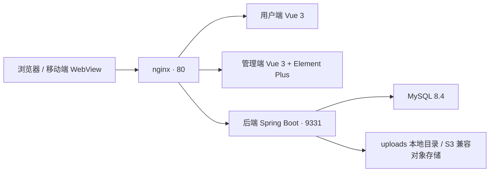

# GameCommunityCreator · 游戏社区建站器

> **开箱即用的「类米游社」游戏垂直社区。** 部署一份，在管理端改站点信息与主题外观，就是你游戏的社区——不用改代码。
>
> 毕业设计作品：功能闭环完整、可直接部署上线，未做生产级压测与安全加固。

一条 `docker compose up -d --build` 就能起来；Windows 上双击根目录的 `deploy.bat` 更省事。

## 它解决什么问题

小团队做的游戏越来越多，玩家却只能挤在贴吧、NGA、Discord、QQ 群里讨论；自建社区又慢又贵。本项目提供一套可直接部署的完整社区产品：

- **零代码建站** —— 站点信息、主题外观、首页模块、板块与内容维度全部在管理端配置，配置与代码分离，不影响后续升级。
- **按「游戏版本 × 玩家进度阶段」组织内容** —— 让攻略在正确的版本、正确的进度下被正确的人看到，这是通用论坛做不到的。
- **内容可控、操作可追溯** —— RBAC 权限体系、帖子审核、举报处理、操作日志。



> 本地开发：两个前端都用 Vite 默认端口（先启动的占 `5173`，另一个自动顺延到 `5174`），`/api` 与 `/static` 已在 `vite.config.ts` 里代理到后端的 `9331`。

## 技术栈

| 层 | 技术 |
|---|---|
| 后端 | Spring Boot 3.5.7、MyBatis-Plus 3.5.5、Hutool 5.8.25；源码目标 Java 17，**编译需 JDK 21**；端口 9331 |
| 用户端 | Vue 3.5 + TypeScript 5.9 + Vite 7 + Pinia + vue-router；**必须托管在域名根路径** |
| 管理端 | Vue 3.5 + Element Plus 2.14.5 + Vite 7；动态菜单路由 |
| 数据 | MySQL 8.4；**不使用物理外键**（逻辑外键 + 索引 + 应用层校验） |
| 部署 | Docker Compose：MySQL + 后端 + nginx（一个 nginx 托管两个前端并反代 `/api`、`/static`） |

## 快速开始

**Windows：双击根目录的 `deploy.bat`。** 它会自检 Docker、首次运行自动生成 `.env`（随机口令与密钥）、构建并启动、等容器就绪后把访问地址打出来。

其他平台等价的手动三步：

```bash
cp docker/.env.example .env        # Windows: copy docker\.env.example .env
#   改 .env 里两项：DB_ROOT_PASSWORD（数据库口令）、JWT_SECRET（openssl rand -hex 32 的输出）
docker compose up -d --build       # 首次要构建镜像，慢；之后再启动是秒级
docker compose ps                  # 三个容器都显示 (healthy) 就算好了
```

| 入口 | 地址 | 默认账号 |
|---|---|---|
| 用户端（社区本身） | <http://localhost> | 玩家 `player1` / `member123` |
| 管理端（后台） | <http://localhost:8081> | `admin` / `admin123`（登录后第一件事改密码） |

生产部署、不用 Docker 的手动部署、首次建站与上线前检查清单，见 **[DEPLOY.md](DEPLOY.md)**。

## 两个最容易卡住的地方

- **首次打开用户端是空的**，这是正常的：建库脚本只装「平台」。进管理端
  「站点配置 → 创建社区」，填社区名称与游戏名称，社区页面就一次性建好了。
- **Windows 上 Docker Desktop 需要 WSL2**：如果 `docker info` 的 `Server:` 一段是空的，
  用管理员终端执行 `wsl --install` 再重启系统。

## 仓库内容

本仓库只放**部署与运行真正需要**的东西：

| 路径 | 说明 |
|---|---|
| `backend/` | Spring Boot 后端（双端共用），端口 9331 |
| `simple-template-f-user/` | 用户端前端（Vue 3），**必须托管在域名根路径** |
| `simple-template-f-admin/` | 管理端前端（Vue 3 + Element Plus） |
| `sql/` | 建库与种子脚本，入口是 `sql/install.sql` |
| `docker/` + `docker-compose.yml` | Docker Compose 一键部署：MySQL + 后端 + nginx |
| `deploy.bat` / `deploy.ps1` | Windows 一键部署脚本，**两者的编码有硬约束，改之前先看 AGENTS.md** |
| `docs/` | 项目背景、开发目的与功能需求 |
| `DEPLOY.md` | **部署说明**：一键部署 / 手动部署 / 首次建站 / 上线前检查清单 |
| `AGENTS.md` | **开发手册**：目录结构、接口与数据模型约定、双端共享代码的红线、踩过的坑 |

**先读哪本**：部署看 [DEPLOY.md](DEPLOY.md)，改代码看 [AGENTS.md](AGENTS.md)，想了解为什么做这个项目看 [docs/项目背景与需求.md](docs/项目背景与需求.md)。

## License

[MIT](LICENSE) © 2026 GameCommunityCreator
