# 用例图（Mermaid）

依据 `pit.md` 的表 2-2 ～ 表 2-17，为每个模块生成对应的用例图。用例名统一使用**动宾结构**（如「修改个人资料」「设置游戏进度」）。

## 一、绘制约定与批注总则

Mermaid **没有原生的 UML 用例图（Use Case Diagram）语法**，因此全部用 `flowchart` 近似表达。凡无法原生实现的部分，在图后统一以「批注」说明，代码内亦以 `%%` 注释标出。

| UML 用例图元素 | 本方案的近似做法 | 是否原生支持 |
| --- | --- | --- |
| 参与者 | 普通方框 `id["名称"]`（**画不出"小人"图标**） | 否 |
| 用例 | 胶囊/椭圆 `id(["用例名"])` | 否（靠形状约定） |
| 系统边界 | `subgraph 模块名 … end` | 近似 |
| 关联（参与者—用例） | 实线箭头 `-->`（UML 中应为无向直线） | 近似 |
| «include» / «extend» | 带标签的虚线箭头 `-.->\|«include»\|`（**无构造型语义**） | 否 |
| 泛化（参与者继承 / 用例继承） | **完全无法表达** | 否 |
| 扩展条件、前置/后置条件、业务规则 | **完全无法表达** | 否 |
| 主参与者 / 次参与者（系统）区分 | **无法表达**，仅能用独立方框标示 | 否 |
| 跨模块用例复用、跨图依赖 | **完全无法表达** | 否 |

> **约定**：批注中的 `「xxx」` 指图内的用例节点；标识符（如 05、11）沿用 `pit.md` 原表编号，未重新编排。

## 二、模块与图号对照

| 图号 | 模块 | 源自 | 标识符 | 参与者 |
| --- | --- | --- | --- | --- |
| 图2-1 | 个人主页模块 | 表2-2 | 11、10 | 普通用户（玩家） |
| 图2-2 | 板块浏览模块 | 表2-3 | 03、04 | 普通用户（玩家） |
| 图2-3 | 攻略发布模块 | 表2-4 | 05 | 普通用户（玩家） |
| 图2-4 | 攻略浏览与检索模块 | 表2-5 | 06、07 | 普通用户（玩家） |
| 图2-5 | 评论互动模块 | 表2-6 | 08、09 | 普通用户（玩家） |
| 图2-6 | 举报模块 | 表2-7 | 12 | 普通用户（玩家） |
| 图2-7 | 管理端登录 | 表2-8 | 13 | 管理员 / 版主 |
| 图2-8 | 用户管理模块 | 表2-9 | 14 | 管理员 |
| 图2-9 | 角色管理模块 | 表2-10 | 15 | 管理员 |
| 图2-10 | 菜单管理模块 | 表2-11 | 16 | 管理员 |
| 图2-11 | 操作日志模块 | 表2-12 | 17 | 管理员（+系统） |
| 图2-12 | 站点配置模块 | 表2-13 | 18、19 | 管理员 |
| 图2-13 | 板块管理模块 | 表2-14 | 20 | 管理员 |
| 图2-14 | 内容维度配置模块 | 表2-15 | 21 | 管理员（+系统） |
| 图2-15 | 帖子审核与举报处理模块 | 表2-16 | 22、23 | 管理员 / 版主 |
| 图2-16 | 数据统计模块 | 表2-17 | 24 | 管理员 / 版主 |

---

## 图2-1　个人主页模块（表2-2）

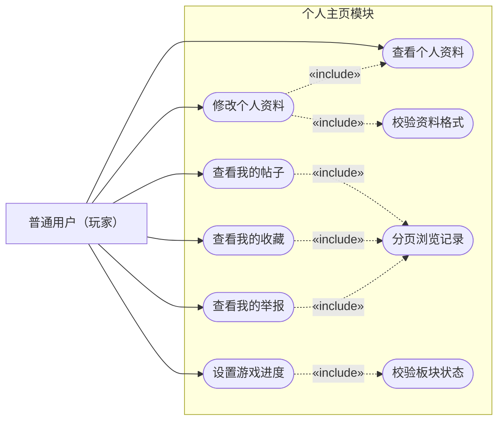

**批注：**

- **标识符对应关系需核对**：原表标识符写作「11、10」，而用例名称写作「查看与修改个人主页、设置我的游戏进度」，两者顺序相反。本图按 11=个人主页、10=游戏进度推定，请与实际《用例清单》核对后修正。
- Mermaid **画不出 UML 参与者的小人图标**，本图用普通方框代替；若要出正式插图，建议用 PlantUML（`@startuml` + `:actor:`）或 Visio/draw.io。
- **«include» / «extend» 不是 Mermaid 原生的构造型**，这里只是"带标签的虚线箭头"，不具备 UML 语义校验能力。
- 「修改个人资料」对「查看个人资料」的依赖是**数据前置**（需先回显当前值），用 «include» 近似；UML 中也可不画，二者不冲突。
- 「查看我的帖子/收藏/举报」三个用例**共用**「分页浏览记录」，用同一 include 目标表示复用——Mermaid 无法表达"一个用例被多处复用"的语义，只能靠连线重复体现。
- 可选流「未登录访问个人主页 → 跳转登录页」是**异常路径**，按 UML 惯例不单独建用例，本图未画出。
- 可选流「板块已关闭，不可设置该板块的进度」是「设置游戏进度」的**前置条件约束**，Mermaid 无法标注条件，故补画「校验板块状态」节点承载该逻辑。

---

## 图2-2　板块浏览模块（表2-3）

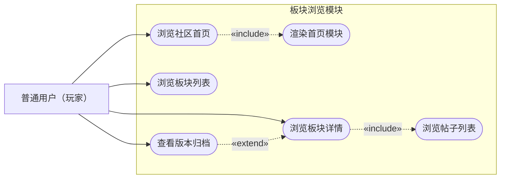

**批注：**

- 「渲染首页模块」的**顺序与开关由管理端配置决定**（图2-12 站点配置模块），属于系统自动执行的内部步骤，无玩家主观发起。按 UML 惯例画成被 «include» 的系统用例，其真实参与者是系统而非人；Mermaid 无法区分主/次参与者。
- **跨模块依赖无法表达**：本模块「渲染首页模块」的输入来自「站点配置模块」，Mermaid 无法画跨图依赖线，必须在批注中说明。
- 「查看版本归档」是从板块详情页内的入口进入，故用 «extend» 表达（**扩展条件：玩家切换到归档页**）；Mermaid 无法标注该条件。
- 可选流「模块被停用 / 板块已关闭 / 空状态提示」都是**分支与异常**，不单独建用例。

---

## 图2-3　攻略发布模块（表2-4）

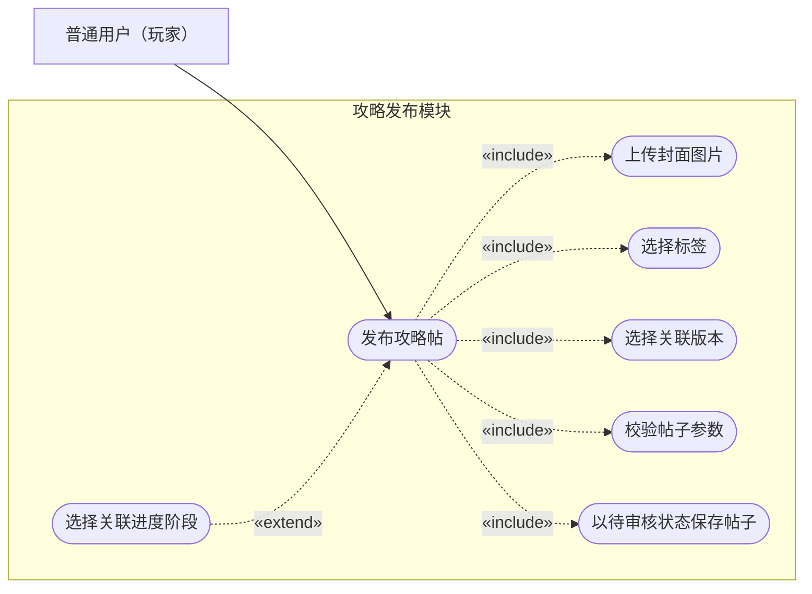

**批注：**

- **必选 vs 可选用例关系不同**：关联版本**必选**（原表可选流明确「未选择关联版本 → 提示为必选项」），故用 «include»；关联进度阶段**可选**，按 UML 语义应作为**扩展用例**用 «extend» 表达。Mermaid 只能靠标签文字区分，箭头本身无语义。
- 「以待审核状态保存帖子」是**状态流转**，UML 用例图不擅长表达状态机，此处补画为 include 节点仅为方便对应实现；真正的状态流转建议另画状态图。
- 后置条件「帖子仅本人『我的帖子』中可见」是对「个人主页模块·查看我的帖子」（图2-1）的**跨模块影响**，Mermaid 无法表达，用批注说明。
- 可选流「帖子审核未通过 → 显示未通过状态」涉及**审核模块（图2-15）的回写**，同样无法在本图内表达。

---

## 图2-4　攻略浏览与检索模块（表2-5）

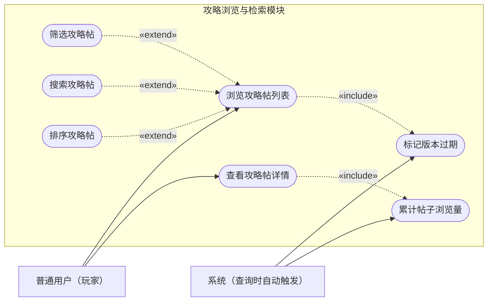

**批注：**

- 「筛选/搜索/排序」均为**可选行为**（「未输入任何条件，默认展示最新帖子」），按 UML 语义是**扩展用例** `«extend»`，不是 `«include»`；Mermaid 无法标注"何时扩展"。
- 「标记版本过期」与「累计帖子浏览量」**没有人类参与者**，由系统在查询/访问时自动执行，属于 UML 中的**次参与者（系统）**。Mermaid 用独立的「系统」方框表示，但**无法表达主/次参与者的区别**。
- 「标记版本过期」是**动态判定**（比对 `post.version_id` 与 `board.current_version_id`），不落库、不隐藏内容——用例图看不出这一点，必须在批注中写明。
- 可选流「请求页码超出数据范围，返回最后一页」属于**分页容错**，不是用例。
- 可选流「帖子已被下架，进入详情时提示内容不可见」是**前置条件被破坏**的异常，不单独建用例。

---

## 图2-5　评论互动模块（表2-6）

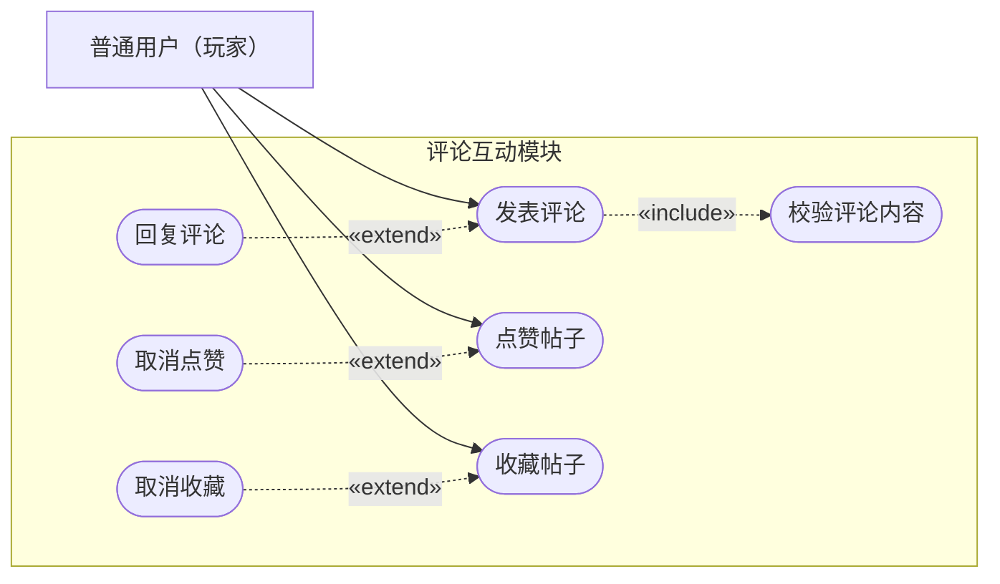

**批注：**

- 「取消点赞」「取消收藏」是**条件扩展用例**：原表写明「重复点击即为取消」，其 **扩展条件为"当前已点赞 / 已收藏"**。Mermaid **完全无法标注扩展条件**，只能用标签写出用例名，条件必须写在批注里。
- 「评论」与「回复」共用同一套保存逻辑（原表「校验内容并保存评论」），故用 «extend» 表达"回复是发表评论的特例"；UML 中也常把「回复评论」直接作为独立用例，两种画法均可。
- 后置条件中**冗余计数字段（`like_count` / `favorite_count` / `comment_count`）与明细表必须同事务一致**——这是实现约束，用例图无法表达。
- 可选流「被回复的评论已被删除，提示『该评论不存在』」是**异常路径**，未建用例。
- 本模块与「攻略浏览模块·查看帖子详情」（图2-4）是**同一页面上的并发交互**，Mermaid 无法表达跨模块的界面耦合。

---

## 图2-6　举报模块（表2-7）

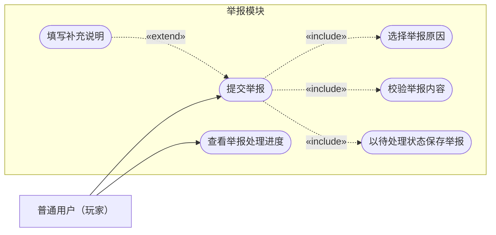

**批注：**

- **跨模块用例复用无法表达**：「查看举报处理进度」在 UML 里就是个人主页模块的「查看我的举报」（图2-1，含在标识符 11 的范围内），本图为体现流程闭环重复列出；**实现时必须复用同一接口**，Mermaid 无法画出"两个图中的同一用例"。
- 「填写补充说明」是**可选项**，用 «extend» 表达；「选择举报原因」为**必选项**（可选流明确提示为必选项），用 «include» 表达。Mermaid 只能靠标签文字区分。
- 「以待处理状态保存举报」是**状态初始化**，用例图无法表达状态机。
- 「处理进度与处理结果」由管理端的「举报处理」（图2-15）回写，属**跨模块数据流**，无法在用例图内画出。
- 可选流「被举报帖子已被删除，仍保留举报记录」是**历史数据保留规则**，不建用例。

---

## 图2-7　管理端登录（表2-8）

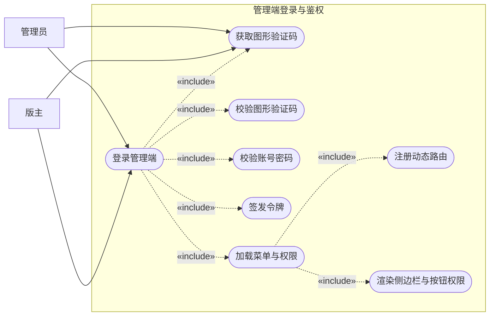

**批注：**

- **泛化关系无法表达**：「管理员」与「版主」在 UML 中应抽象出一个父参与者「后台用户」，二者以**泛化箭头**继承它。Mermaid 的 `flowchart` **没有泛化箭头**，本图只能把两者并列为独立参与者、各自连边。**这是本图最大的表达缺失**，正式插图请改用 PlantUML 或 draw.io。
- **参与者数量偏多导致连线冗杂**（两个参与者 × 两个用例）；UML 中可用泛化消除，Mermaid 做不到。
- 「校验图形验证码 / 校验账号密码 / 签发令牌 / 注册动态路由」都是**系统内部步骤**，无人类参与者，按 UML 惯例画成被 «include» 的系统用例。
- 「校验后立即作废验证码」、「令牌走 `Authorization: Bearer` 头且两端令牌不可跨用」等**安全约束**，Mermaid 无法标注。
- 可选流「令牌失效 → 跳转登录页重新登录」是**会话异常**，不建用例。
- 可选流「账号未分配任何角色 → 无菜单显示」是「加载菜单与权限」的**边界情况**，不建用例。

---

## 图2-8　用户管理模块（表2-9）

```mermaid
%% 无法原生表达：用户名唯一性约束、"系统管理员不可删除"等业务规则
flowchart LR
    admin["管理员"]
    subgraph B8["后台用户管理"]
        direction TB
        uc_query(["查询后台账号"])
        uc_add(["新增后台账号"])
        uc_role(["分配角色"])
        uc_edit(["修改后台账号"])
        uc_toggle(["启用停用账号"])
        uc_reset(["重置密码"])
        uc_del(["删除后台账号"])
        uc_checkname(["校验用户名唯一"])
    end
    admin --> uc_query
    admin --> uc_add
    admin --> uc_edit
    admin --> uc_toggle
    admin --> uc_reset
    admin --> uc_del
    uc_add -.->|«include»| uc_role
    uc_add -.->|«include»| uc_checkname
```

**批注：**

- 「启用账号」与「停用账号」是两个独立用例，但 Mermaid 连线会重复；本图用**一个用例名「启用停用账号」合并表达**，属于简化，与 UML「一用例一名字」的规范有偏差。
- 「校验用户名唯一」是**数据约束**，UML 用例图中通常写在前置条件里而非画成用例；此处画出是为方便对应到接口校验逻辑。
- 「删除系统管理员账号时被拒绝」是**业务规则**（原表可选流），Mermaid **无法表达拒绝类规则**，用批注说明。
- 后置条件「相应账号的权限随之生效」隐含**与角色管理模块（图2-9）的耦合**，无法在用例图内表达。

---

## 图2-9　角色管理模块（表2-10）

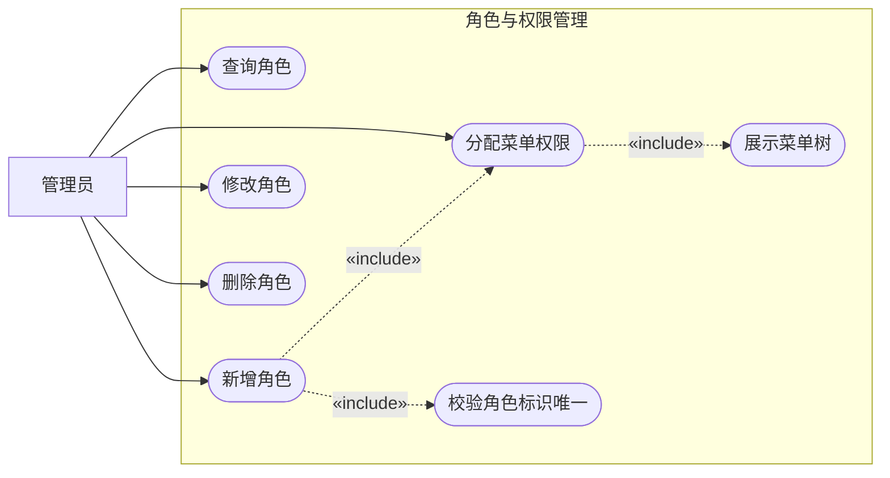

**批注：**

- 「分配菜单权限」以**树形结构勾选**目录/菜单/按钮三级节点，这是一个**界面的呈现方式**，Mermaid 无法表达 UI 形态。
- 「角色标识重复」「删除系统管理员角色被拒绝」「角色已被账号引用需先解除绑定」都是**业务规则约束**，Mermaid 完全无法标注。
- 角色与菜单的关联（`sys_role` ↔ `sys_menu`）是**与菜单管理模块（图2-10）共用的数据**，「角色管理」和「菜单管理」都依赖它，跨模块数据耦合无法在用例图内表达。
- 可选流「未勾选任何菜单 → 该角色账号登录后无菜单显示」是**边界情况**，不建用例。

---

## 图2-10　菜单管理模块（表2-11）

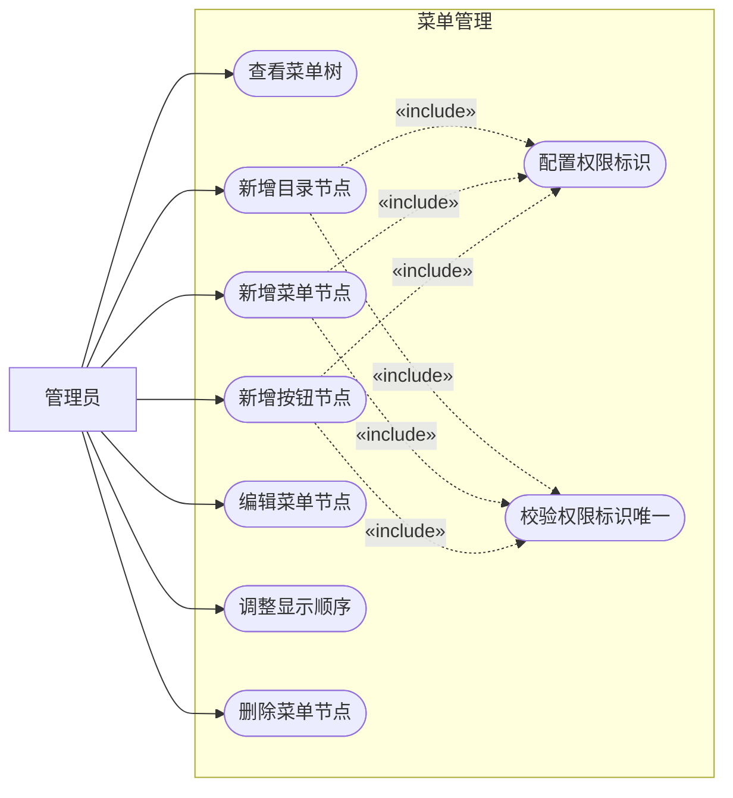

**批注：**

- 原表强调「目录、菜单、按钮**三级节点**」，这层**层级结构**在用例图中看不出来——用例是平的，层级关系属于数据模型而非用例关系。Mermaid 无法表达，需另配**类图 / ER 图**（`sys_menu` 的 `parent_id` 自关联）。
- 「新增目录 / 新增菜单 / 新增按钮」三者本可合并为一个「新增菜单节点」用例（原表的用例名只有一个「菜单管理」），此处按三级节点拆开是为了对应实现；**这与 UML"一个用例一个用户目标"的粒度原则有出入**。
- 「权限标识重复」「删除含子节点的菜单需先删子节点」「节点已被角色引用需先解除关联」都是**业务规则约束**，Mermaid 无法标注。
- 本模块描述中的「**不修改前端代码即可调整功能入口与按钮权限**」是本项目的核心设计点，属于**架构性质的价值主张**，用例图无法承载，应写入正文文字。

---

## 图2-11　操作日志模块（表2-12）

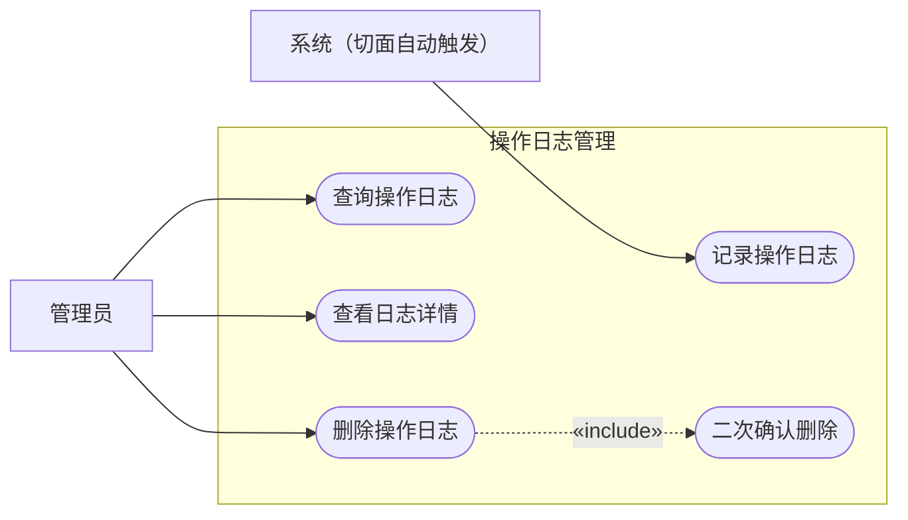

**批注：**

- 「记录操作日志」由系统**切面（AOP）在业务方法执行后自动触发**，没有人类参与者，是 UML 中的**次参与者（系统）**。Mermaid 无法区分主/次参与者，故用独立的「系统」方框表示。
- **跨模块依赖无法表达**：日志的**数据来源**是其他所有模块（图2-8 ～ 图2-15）的增删改操作，这在用例图里根本画不出来，只能在批注说明。
- 「二次确认删除」是**前端交互步骤**，严格说不是用例（无独立用户目标）；此处画出便于对应实现，属简化。
- 「日志数据量较大时按分页展示」「查询结果为空显示空状态」是**非功能/边界表现**，不建用例。

---

## 图2-12　站点配置模块（表2-13）

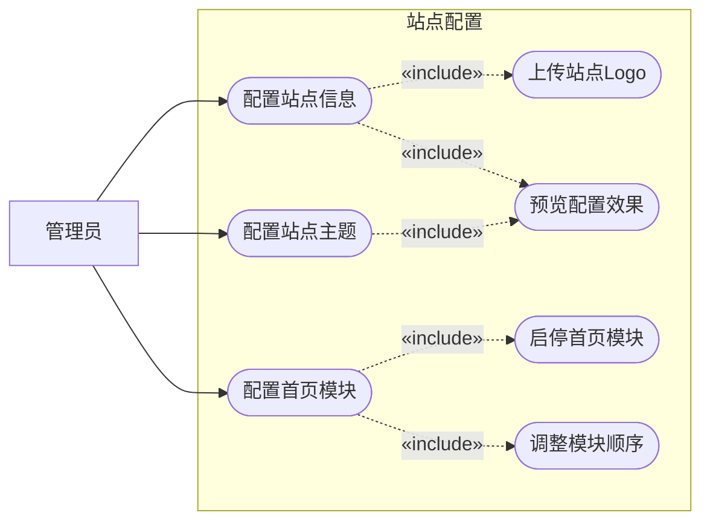

**批注：**

- **本模块是用户端首页的上游依赖**：这里保存的配置直接决定「板块浏览模块·渲染首页模块」（图2-2）的行为。Mermaid **无法画跨图依赖**，这是本图最需要文字补充的地方。
- 「保存即预览」是「配置站点主题 / 站点信息」保存后的**即时生效行为**，无独立用户目标，用 «include» 表述；严格 UML 中应体现为**后置条件**。
- 「用户端刷新后生效、后端无需重启」是本模块的核心卖点（**配置化、零代码**），属于**非功能需求**，用例图无法表达，需写入正文。
- 可选流「颜色值格式非法」「Logo 上传失败或超限」「保存失败提示重试」都是**输入校验与失败处理**，不建用例。

---

## 图2-13　板块管理模块（表2-14）

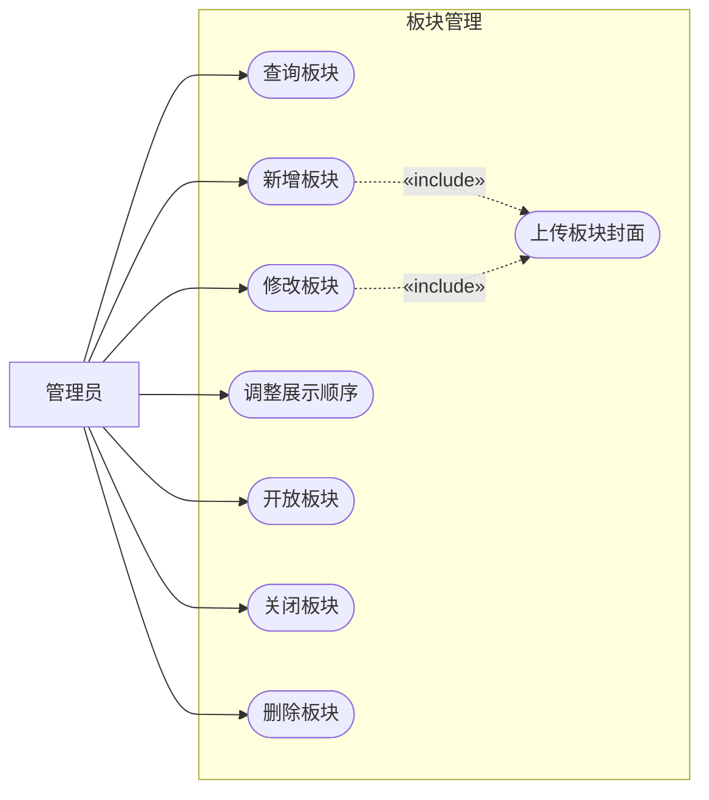

**批注：**

- 原表的核心业务规则——「**板块下存在帖子时不允许删除，只能关闭**」——是**删除操作的前置守卫**，Mermaid **无法表达条件性拒绝**。本图刻意**不**画成「删除板块 → 校验帖子」的 include 节点，以避免误导实现；该规则请写入正文与接口校验逻辑。
- 「开放板块 / 关闭板块」是**状态字段变更**（原表后置条件「板块数据与用户端展示同步变化」），用例图无法表达状态机与联动。
- 「板块名称重复」「封面上传失败或超限」是**输入校验**，不建用例。
- 与「内容维度配置模块」（图2-14）的依赖（版本、进度阶段都挂在板块下）**无法在用例图内表达**。

---

## 图2-14　内容维度配置模块（表2-15）

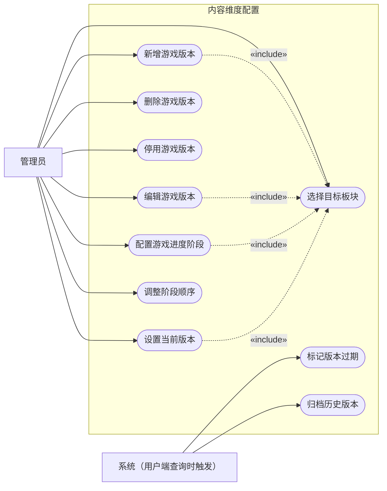

**批注：**

- **「设置当前版本」有强事务约束**：原表要求「在同一事务内将该板块其他版本置为非当前版本，并更新板块的当前版本标识」。**UML 用例图无法表达事务性**，Mermaid 更做不到，必须在批注中写明（表结构上体现为 `board.current_version_id` 为唯一事实源）。
- **「标记版本过期 / 归档历史版本」不是管理员发起的用例**，而是**用户端查询时按需计算**的结果（`post.version_id ≠ board.current_version_id`），且**不落库、不存状态字段、不隐藏历史内容**。本图用「系统」方框表达触发方，但**动态判定的本质无法在用例图中体现**，切勿据此实现出一个 `expired` 字段。
- 「版本已被帖子引用时执行删除 → 提示改为停用」是一条**替代路径**。UML 中 "删除失败后改走停用" 并非合法的 «extend» 关系，故本图**不画连线**，只把「删除游戏版本」与「停用游戏版本」并列为独立用例，用本批注说明二者的取舍关系。
- 「版本切换过程中发生异常，事务回滚」是**异常处理**，不建用例。
- 本模块与用户端「攻略浏览与检索模块」的**过期标记**（图2-4）是同一逻辑的两端，跨模块呼应无法在单张用例图内表达。

---

## 图2-15　帖子审核与举报处理模块（表2-16）

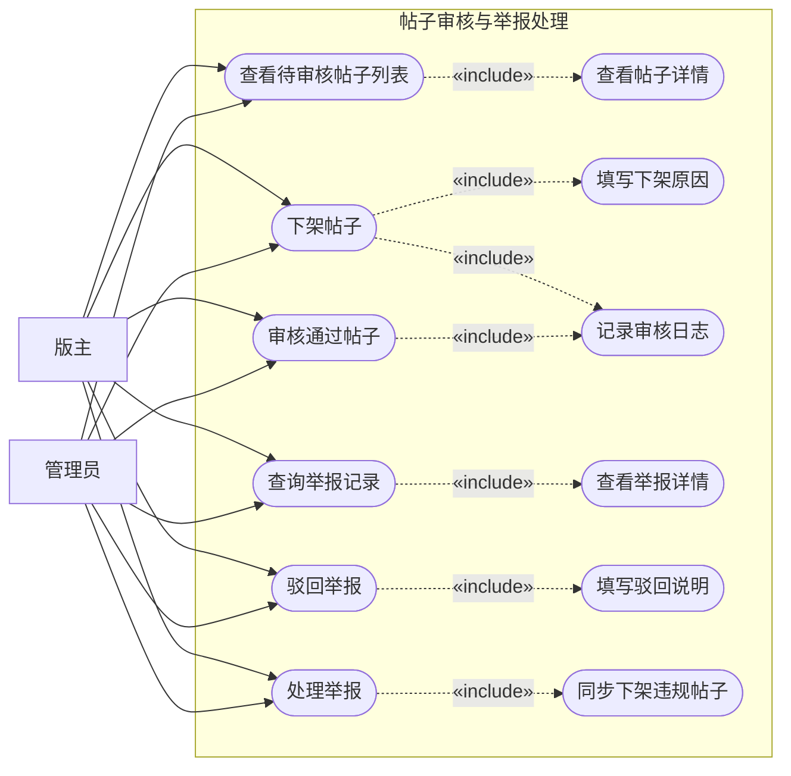

**批注：**

- **泛化关系无法表达**：「管理员」与「版主」应泛化自「后台用户」，且版主只拥有审核/举报处理等**部分权限**。Mermaid 的 `flowchart` **没有泛化箭头**，只能并列为两个参与者并重复连边（本图连线因此偏多）。权限差异实际由**菜单/按钮权限标识**控制，用例图完全看不出这一点——这是本图最需要文字补充处。
- 「填写下架原因」「填写驳回说明」是**条件必填项**（可选流 1、3 明确要求），用 «include» 近似；严格来说这是**业务校验规则**，不是独立用例。
- 「同步下架违规帖子」是处理举报时**可选触发的动作**（原表「必要时同步下架」），按 UML 语义更接近**条件 «extend»**，本图用了 «include»，属简化。
- 「帖子或举报已被其他管理员处理，提示状态已变更」是**并发状态冲突**，Mermaid **无法表达并发**。
- 「被举报帖子已被删除，保留举报记录并说明情况」是**历史数据保留规则**，不建用例。
- 「记录审核日志」与「操作日志模块」（图2-11）是同一机制的**跨模块复用**，无法在用例图内表达。

---

## 图2-16　数据统计模块（表2-17）

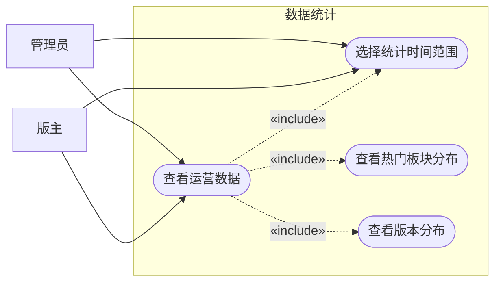

**批注：**

- 「统计数据**以图表形式展示**」是**呈现方式**，UML 用例图天然不表达 UI 形态，Mermaid 更无法表达（如需展示布局，应另配界面原型图）。
- 「用户数、帖子数、评论数」等**统计口径**（是否去重、是否含未审核内容）在用例图中无法体现，需在正文或接口文档中定义。
- 「管理员」与「版主」的**泛化关系**同样无法表达（同图2-7、图2-15），此处并列连边。
- 「所选时间范围内无数据，图表显示为空」「数据量较大时统计耗时增加，前端显示加载状态」是**非功能需求**，不建用例。

---

## 三、全局遗留与后续建议

1. **标识符缺口**：`pit.md` 从表 2-2（标识符 11、10）起，未包含标识符 01、02（可能还有 03 之前的项）对应的表 2-1。**图2-1 ～ 图2-16 未覆盖这部分用例**，建议补齐后一并出图。
2. **标识符编号混乱**：表 2-2 的标识符是「11、10」而表 2-3 起是「03、04」递增，且用户端（03～12）与管理端（13～24）混排。若用于论文，建议把标识符与图号重新对齐。
3. **Mermaid 无法表达、已在各图批注中列明的元素**，汇总如下（正式插图建议改用 PlantUML 或 draw.io）：
   - 参与者"小人"图标、参与者/用例的**泛化箭头**；
   - «include» / «extend» 的**构造型语义与扩展条件**；
   - **前置/后置条件、业务规则、事务与并发约束**；
   - **主/次参与者**区分、**跨模块依赖与用例复用**；
   - **状态流转、非功能需求（性能、UI 呈现、零代码配置）**。
4. 本文件若要并入 `pit.md`（紧随各张用例描述表），可直接整体追加；两文件内容不冲突。
